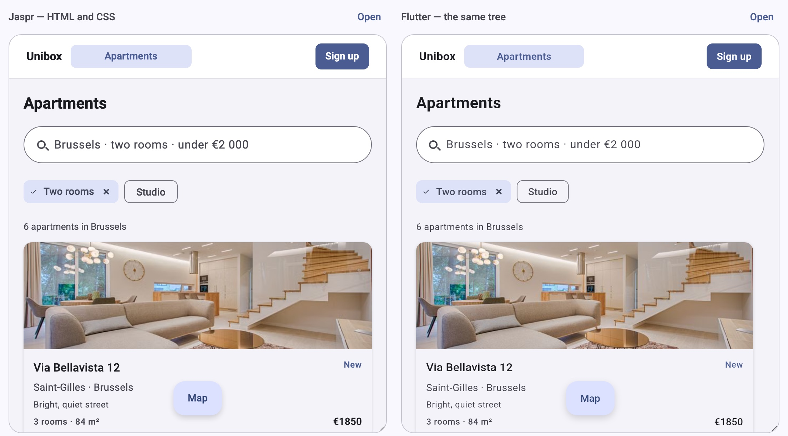

# Unibox

A search engine, a link preview and a reader whose JavaScript failed all see the same
thing in a Flutter screen: nothing. Flutter draws into a canvas, so there is no text to
index and no link to follow. The usual fix is to write that page again in HTML, and then
to keep two designs in step — which, a week later, they are not.

Unibox removes the second design. A screen is one immutable Dart tree:
[`unibox_flutter`](packages/unibox_flutter) draws it as widgets,
[`unibox_html`](packages/unibox_html) renders it as a document a crawler reads, and one table of
expected appearance holds both renderers to the same answer.

<p align="center">
  
</p>

<p align="center">
  <sub>One tree, drawn twice: <code>/web/listings/</code> on the left, <code>/flutter/listings/</code> on the right.</sub>
</p>

## Features

- 🧩 **One tree, two renderings** — the same nodes are Flutter widgets in the app and HTML with CSS in the browser, so the design is written once.
- 🔍 **A page a search engine reads** — real text, headings, links, `alt`, landmarks and metadata: what a crawler, a link preview and a reader without JavaScript see is the page itself.
- 🖐 **Take the page over, and keep the reader's place** — Flutter boots into the document it was served, prefetched while they read and started at their first intent, and the scroll of every keyed region and the presses they made come back with it.
- ⚡ **Or let the page run on its own** — the same tree compiled to JavaScript renders into the page with `unibox_dom` and reacts through its store, so a page that should stay light needs no Flutter binary at all.
- 🟩 **Rendered from Node too** — pure Dart with no dependencies, so a document is produced in a server, a build step, a CLI, or compiled to JavaScript for a backend that is not Dart.
- 🧪 **Parity tested, not promised** — `unibox_testing` holds the renderers to one table of expected appearance, read back out of each one's own output.
- 🧱 **Material 3 as values** — the type scale, the colour roles and the components as an optional package, drawn by the renderers rather than by a third runtime.

## Contents

- [How it works](#how-it-works)
- [Serving a tree](#serving-a-tree)
- [Quick start](#quick-start)
- [Flutter hydrates it](#flutter-hydrates-it--the-least-to-change)
- [The DOM hydrates itself](#the-dom-hydrates-itself--nothing-of-flutter)
- [The nodes](#the-nodes)
- [Colours](#colours)
- [Typography](#typography)
- [Motion](#motion)
- [Semantics](#semantics)
- [What the host owns](#what-the-host-owns)
- [How the two renderers stay in step](#how-the-two-renderers-stay-in-step)
- [Packages](#packages)
- [Building with an AI assistant](#building-with-an-ai-assistant)
- [Development](#development)

## Why this exists

A search engine, a link preview and a reader whose JavaScript failed all see the same thing in
a Flutter screen: nothing. Flutter draws into a canvas, so there is no text to index — and the
usual fix is to write that page again as HTML, then keep two designs in step, which drift the
week after they are written.

Unibox removes the second design: the screen is written once, as a tree, and that tree is both
the document and the application.

## How it works

A screen is a `Box` with children. Each child is another node — a text, an image, a link, a grid,
a stack — and every node is an immutable Dart object. Nothing in the description mentions Flutter
or HTML: no widget, no tag, no stylesheet.

```dart
final page = Box(
  padding: BoxSpacing.all(16),
  gap: 12,
  children: <UINode>[
    TextNode('Apartments', fontSize: 24, fontWeight: FontWeight.bold),
    GridNode(minItemWidth: 380, children: listings),
  ],
);

runApp(MaterialApp(home: page.toWidget()));           // Flutter draws it as widgets
final html = toDocument(page, title: 'Apartments');  // the web reads it as a page
```

Two functions, one tree. `toWidget()` builds the widgets; `toDocument()` writes the page and its
head. Which one you call is the only decision, and the tree is the same either way.

Two things keep the two equal: the model states every default — an unset direction is a column, an
unset text size is 16 — so neither target answers with its own; and a test compares what each
renderer produced, so one that drifts fails instead of shipping. Neither wraps the other either: on
a phone the tree is Flutter widgets, in a browser markup and CSS, with no WebView between them.

What the description does *not* contain is what only your application knows — how wide the window
is, what a tap does, what the document is called. Those are the host's; see
[what the host owns](#what-the-host-owns).

## Serving a tree

A Flutter screen is a canvas: to a crawler, a link preview and a reader without JavaScript it is
nothing at all. Unibox renders the tree as a page first — real text, real links, real headings — so
**what a search engine reads is the page a visitor lands on**.

The page is the same either way. What differs is what brings it to life.

| | **Flutter hydrates it** | **The DOM hydrates itself** |
| --- | --- | --- |
| The page becomes | the app, repainted into a canvas | the same elements, made live |
| What you write in Unibox | the screen a visitor lands on | every screen that must work without Flutter |
| What you ship | the Flutter build you already have | a folder of files — any static host serves it |
| What it costs | one repaint when the app arrives | every interaction is a node |

### Flutter hydrates it — the least to change

Reach for this when the application already exists. You describe **one screen**, the one that has to
be findable, and stop: Flutter boots into the page it was served and draws everything after it —
the dialogs, the forms, the list behind the list — as ordinary Flutter, exactly as you write it
today.

```dart
final String page = toDocument(
  ListingsPage(listings),
  title: 'Apartments in Amsterdam',
  takeover: const Takeover(boot: '../../flutter/app.js'),
);
```

The visitor does not start again in the swap. The page records where they scrolled and what they
pressed; the app opens at that scroll and replays the press.

```dart
void main() => runApp(
  ExampleApp(
    offsets: scrollOffsetsFromPage(),
    presses: pressesFromPage(),
  ),
);
```

The app downloads while they read and starts at their first intent, never mid-paint, so the page is
finished before the engine is asked for. The handover itself is a repaint, and a brief flash is the
honest price of it.

### The DOM hydrates itself — nothing of Flutter

Same tree, written by `unibox_html` and made live by `unibox_dom`: one small bundle, compiled from
Dart, that **adopts** the markup the server wrote — the same elements, the same classes — and keeps
it in step with the stores the tree created. A press runs the same Dart closure Flutter would have
run. No engine, no repaint, no flash.

**The size is the argument:** this site's whole client, renderer and stores and trees included, is
67 KB gzipped. Its Flutter build is 718 KB before Canvaskit.

The cost is the mirror image. An interaction has to exist as a node, so a dialog is a node in the
tree rather than a widget only the app can draw.

A dialog, a filter, a reorder — each works without Flutter. A widget Flutter alone can draw stays in
the app, and neither way asks you to rewrite the rest: the screens that do not have to be found stay
ordinary Flutter, untouched.

## Quick start

The packages are not on pub.dev yet (`publish_to: none` keeps them off until a
release is cut), so point your pubspec at the checkout:

```yaml
dependencies:
  unibox_core:
    path: ../unibox/packages/unibox_core
  unibox_flutter:
    path: ../unibox/packages/unibox_flutter
  unibox_html:               # the web: a document a crawler can read
    path: ../unibox/packages/unibox_html
  unibox_material:           # optional: the Material 3 type scale
    path: ../unibox/packages/unibox_material
```

```dart
// Flutter
runApp(MaterialApp(home: tree.toWidget()));

// the web: a page a crawler reads, and the app takes over
final String page = toDocument(tree, title: 'My page');
```

Keep the tree in a package of its own that imports `unibox_core` and neither
renderer, so both hosts can use it and neither has to know which target draws it.
[`example/`](example/README.md) is that arrangement in full: one page node — a
listings page, a navigation bar and a sign-up dialog — shared by a Flutter app and
a static site, each host a single small file.

## The nodes

There are eleven node types. Each one is an immutable Dart object with a `const`
constructor, and each one describes *what* it is rather than which framework draws
it. Style values — colours, spacing, borders, typography — are separate objects
that a node takes as parameters, so a look can be reused as one `const BoxStyle`
instead of being repeated.

The ten: [`Box`](#box), [`TextNode`](#textnode), [`ImageNode`](#imagenode),
[`LinkNode`](#linknode), [`StackNode`](#stacknode-and-positionednode) with
[`PositionedNode`](#stacknode-and-positionednode), [`TextInputNode`](#textinputnode),
[`StatefulNode`](#statefulnode), [`OverlayNode`](#overlaynode) and
[`EmbedNode`](#embednode).

Every node accepts a `key`. Renderers hand it to the target's own key mechanism, so
when a list is reordered each child keeps its state: typed text stays in the field
it was typed into.

### Box

The container. It lays children out in a row or a column, spaces them, sizes
itself, paints a background, a border, rounded corners and a shadow, and reacts to
taps and hover.

```dart
Box(
  direction: Axis.horizontal,
  gap: 12,
  padding: BoxSpacing.symmetric(horizontal: 16, vertical: 10),
  backgroundColor: BoxColor.white,
  border: BoxBorder(color: BoxColor.rgb(0xE5, 0xE7, 0xEB)),
  borderRadius: 10,
  onTap: open,
  children: <UINode>[TextNode('Open')],
);
```

**Layout**

| Parameter | Type | Default | Meaning |
| --- | --- | --- | --- |
| `children` | `List<UINode>` | empty | The nodes laid out inside. |
| `direction` | `Axis?` | column | `Axis.horizontal` is a row, `Axis.vertical` a column. |
| `mainAlign` | `MainAlign?` | start | Distribution along the direction: `start`, `center`, `end`, `spaceBetween`, `spaceAround`, `spaceEvenly`. |
| `crossAlign` | `CrossAlign?` | start | Alignment across the direction: `start`, `center`, `end`, `stretch`. |
| `gap` | `double?` | none | Space between two children. For space at the edges, use `padding`. |
| `flex` | `int?` | none | Share of the free space this box takes inside its parent: `flex: 1` is an `Expanded` in Flutter and `flex-grow: 1` on the web. |
| `overflow` | `Overflow?` | visible | `hidden` clips the content, `scroll` makes the box scroll along its direction. |

**Size**

| Parameter | Type | Default | Meaning |
| --- | --- | --- | --- |
| `width`, `height` | `double?` | content size | Logical pixels. `double.infinity` fills the space the parent gives. |
| `minWidth`, `maxWidth`, `minHeight`, `maxHeight` | `double?` | none | Bounds the box keeps even when its content wants otherwise. |
| `padding` | `BoxSpacing?` | none | Space inside the box, around its children. |
| `margin` | `BoxSpacing?` | none | Space outside the box. |

**Paint**

| Parameter | Type | Default | Meaning |
| --- | --- | --- | --- |
| `backgroundColor` | `BoxColor?` | none | Colour behind the children. |
| `border` | `BoxBorder?` | none | Line around the box, with a width, a colour and — for a shape's open outline — a cap. |
| `borderRadius` | `double?` | square | Corner radius in logical pixels, the same on all four. |
| `corners` | `BoxBorderRadius?` | square | The radius of each corner, for a box that is not round on all four — a filled text field rounds its top and leaves the bottom square. Takes precedence over `borderRadius`. |
| `shadow` | `BoxShadow?` | none | Drop shadow: colour, offset, blur, spread. |
| `shape` | `BoxShape?` | the rectangle | The outline the box is painted in, instead of its rectangle: a path in a view box, stretched to the box. The background fills it, the `border` is drawn along it, and the children are clipped to it when the box also says `overflow: Overflow.hidden`. See [shapes](#shapes). |
| `opacity` | `double?` | solid | `0` (invisible) to `1` (solid). The box keeps its room either way. |
| `transform` | `BoxTransform?` | none | Moves, turns or scales the box about its centre (`scale`, `rotation` in degrees, `offsetX`, `offsetY`). It paints differently without taking different room, so text inside never reflows. |
| `transition` | `BoxTransition?` | none | How long a change of the paint, the opacity or the transform takes, and how it eases. See [motion](#motion). |

**Interaction**

| Parameter | Type | Default | Meaning |
| --- | --- | --- | --- |
| `onTap` | `TapCallback?` | none | Tapped, clicked, or activated with `Enter`/`Space` once the box is focusable. |
| `onTapDown` | `TapDownCallback?` | none | A press lands: where it landed inside the box and what pressed it (touch, mouse, pen, keyboard). It fires before `onTap`, which is what an effect that starts at the pointer needs. |
| `onLongPress` | `LongPressCallback?` | none | Pressed and held. |
| `onHover` | `HoverCallback?` | none | Pointer entered or left the box. |
| `enabled` | `bool` | `true` | A disabled box keeps its layout, drops its callbacks, leaves the tab order and is announced as disabled. |
| `semantics` | `BoxSemantics?` | none | What the box *is* for a screen reader: role, label, state, element. |
| `stateStyles` | `Map<BoxState, BoxStyle>?` | none | Looks for `hover`, `focus`, `pressed` and `disabled`, layered over the resting one. |
| `hoverStyle` | `BoxStyle?` | none | Shorthand for the `hover` entry of `stateStyles`. |

**Styles**

Instead of the flat parameters above, a box can wear one or more reusable bags:
`styles: <BoxStyle>[...]`. The bags merge left to right — a later bag wins a value
over an earlier one — and a flat parameter wins over all of them. `textStyle` is
different from the others: it is inherited by the texts inside the box (see
[typography](#typography)).

```dart
const cardBase = BoxStyle(
  padding: BoxSpacing.all(16),
  backgroundColor: BoxColor.white,
  borderRadius: 12,
);
const cardBusy = BoxStyle(backgroundColor: BoxColor.rgb(0xF3, 0xF4, 0xF6));

const row = Box(
  styles: <BoxStyle>[cardBase, cardBusy],
  padding: BoxSpacing.all(8), // wins over both bags
);
```

**On each target.** A box is a `Flex` (`Row`/`Column`) wrapped in `Padding`,
`DecoratedBox`, `ClipRect`, `SizedBox` and `GestureDetector`/`MouseRegion` in
Flutter, and one `<div>` with `display: flex` and the matching CSS in the browser.
A box with no children still renders its flex container, so an empty box takes the
size the tree gave it instead of collapsing differently on each side.

**Worth knowing.** A box without a direction is a **column**, not "whatever the
platform does", so `gap` and the alignments work in every box. Nothing is inherited
from a box to its children except typography: a box never pushes its padding, gap or
alignment down.

A child that fills the width needs a parent that offers one: `width: double.infinity`
takes the space it is given, and a browser can only resolve `100%` against a parent
that has a width — so inside a column that hugs its content, state
`crossAlign: CrossAlign.stretch` on the column and the two targets agree.

#### Shapes

A box can be painted in an outline that is not a rectangle. The outline is a
`BoxShape`: a path in a **view box**, so the same value draws the same silhouette at
40 pixels and at 400.

```dart
const BoxShape hexagon = BoxShape(
  viewBoxWidth: 100,
  viewBoxHeight: 100,
  commands: <BoxPathCommand>[
    BoxPathMoveTo(50, 0),
    BoxPathLineTo(93, 25),
    BoxPathLineTo(93, 75),
    BoxPathLineTo(50, 100),
    BoxPathLineTo(7, 75),
    BoxPathLineTo(7, 25),
    BoxPathClose(),
  ],
);

Box(width: 40, height: 40, shape: hexagon, backgroundColor: BoxColor.white)
```

The commands are the ones SVG's `d` attribute has — `M`, `L`, `C`, `Q`, `A` and `Z`
— and every renderer has a method for each, so neither parses what the other wrote.
The model ships three values over that vocabulary, because they are asked for far more
often than the rest: `BoxShape.circle`, `BoxShape.ring` and `BoxShape.arc`.

```dart
// A band: the region between the edge and a circle 12 units inside it.
Box(width: 96, height: 96, shape: BoxShape.ring(thickness: 12), backgroundColor: grey)

// A value over it: the same band, a fraction of a turn, clockwise from twelve.
Box(width: 96, height: 96, shape: BoxShape.ring(thickness: 12, sweep: 0.42), backgroundColor: accent)

// A line: a circle's centreline, run along by an open path. What paints it is the border,
// and `cap` is what its two ends look like — which is how Material's indicator is drawn.
Box(
  width: 48,
  height: 48,
  shape: BoxShape.arc(stroke: 4, sweep: 0.42, viewBox: 48),
  border: BoxBorder(width: 4, color: accent, cap: BoxStrokeCap.round),
)
```

Five things follow from a shape:

- **The fill is the shape.** `backgroundColor` fills the path rather than the
  rectangle, and `border` is a stroke along the same path.
- **`fillRule` decides what is inside.** `BoxFillRule.evenOdd` punches a hole: two
  circles become a ring, which is how a donut is drawn without a second outline.
- **An open outline is a line, not a region.** `BoxShape.arc` closes nothing, so what a
  reader sees is the border's stroke — and `BoxBorder.cap` (`butt`, `round`, `square`)
  states how its two ends are drawn. A cap on a rectangle draws nothing, so
  `validateTree` reports one there.
- **Layout does not change.** Children are laid out in the same rectangle as before,
  which is what puts a label inside the hole of a ring; `overflow: Overflow.hidden`
  is what clips them to the outline.
- **A shape paints; it does not cast.** It has no shadow (put the shadow on the box
  around it) and it does not ease (there are no numbers to interpolate between two
  outlines). `validateTree` reports a shaped box that also names a shadow or a
  corner radius, because a box has one outline.

### TextNode

A run of text.

```dart
TextNode('Join Unibox', fontSize: 22, fontWeight: FontWeight.bold);
```

| Parameter | Type | Default | Meaning |
| --- | --- | --- | --- |
| `text` | `String` | required | The characters to draw. |
| `headingLevel` | `int?` | none | `1`–`6` makes it a heading: `<h1>`–`<h6>` on the web, a heading of that level in Flutter's accessibility tree. It changes no look. |
| `fontSize` | `double?` | inherited | Logical pixels. |
| `fontWeight` | `FontWeight?` | inherited | `normal`, `medium`, `semiBold`, `bold` — `400`–`700` on both targets. |
| `color` | `BoxColor?` | inherited | Colour of the glyphs. |
| `lineHeight` | `double?` | inherited | Multiple of the font size. A line box is `fontSize * lineHeight` tall on both targets. |
| `fontFamily` | `String?` | the platform's UI font | One family name, resolved by the host. |
| `letterSpacing` | `double?` | inherited | Extra space between characters, in logical pixels. |
| `textAlign` | `TextAlign?` | start | `left`, `center`, `right`, `justify`. |
| `padding` | `BoxSpacing?` | none | The space inside the field; padding on the box around it sits outside the control. |
| `maxLines` | `int?` | unlimited | Number of lines the text may occupy. |
| `overflow` | `TextOverflow?` | none | How text too long for its lines is cut: `clip` or `ellipsis`. With `maxLines` it cuts after those lines, without it on the single line. |
| `style` | `BoxTextStyle?` | none | A bundle of the typography values; a flat parameter wins. |

**On each target.** A `<span>` with the typography as CSS in the browser, a `Text`
in Flutter. A heading becomes `<h1>`–`<h6>` with the browser's own heading styles
turned off (no margin, size or weight of its own), so the tree still decides how it
looks.

### ImageNode

A picture, from a URL or from the assets the host ships.

```dart
ImageNode('https://example.com/room.jpg', alt: 'A bright room', fit: ImageFit.cover);
```

| Parameter | Type | Default | Meaning |
| --- | --- | --- | --- |
| `src` | `String` | required | `http`/`https` loads from the network, anything else is an asset path. |
| `alt` | `String` | `''` | Text for screen readers and for a failed load. Empty means decorative. |
| `width`, `height` | `double?` | natural size | Logical pixels; `double.infinity` fills. One dimension keeps the aspect ratio. |
| `fit` | `ImageFit?` | `scaleDown` | `cover`, `contain`, `fill`, `scaleDown`. |
| `borderRadius` | `double?` | square | Rounds the corners and clips the picture. |
| `srcSet` | `Map<int, String>` | `{}` | Candidate widths and their URLs, narrowest first. The web picks one; Flutter loads `src`. |
| `sizes` | `String?` | none | How wide the image is laid out, in CSS `sizes` syntax. Read only with `srcSet`. |
| `loading` | `ImageLoading` | `eager` | `eager`, `lazy` or `auto`. Web only. |
| `fetchPriority` | `ImageFetchPriority` | `auto` | `high`, `low` or `auto`. Web only. |

**Worth knowing.** The default fit is the model's, not the platform's: without it a
Flutter `Image` scales a picture down while a browser stretches it over its box, and
the same image looked different on each target.

The four responsive fields are the one part of a node the web renderer reads and
Flutter cannot: they become `` attributes (`srcset`, `sizes`, `loading`,
`fetchpriority`, and the element's `width`/`height` so the browser reserves the box
before the picture arrives). Flutter loads a single source, so ship `src` at the size
a phone needs and the denser candidates are a free improvement on the web.

### LinkNode

A link around one child. It renders as a real `<a href>` on the web, so it works
without JavaScript and a crawler can follow it.

```dart
LinkNode('https://unibox.dev', child: TextNode('Read the docs'));
```

| Parameter | Type | Default | Meaning |
| --- | --- | --- | --- |
| `url` | `String` | required | The destination. |
| `child` | `UINode` | required | What is drawn inside the link; exactly one node. |
| `newTab` | `bool` | `false` | Opens elsewhere. The web renderer adds `target="_blank"` with `rel="noopener noreferrer"`. |
| `onTap` | `TapCallback?` | none | Answers the press. The tree handles it and the link is not followed: on the web a plain click cancels the navigation, and Flutter calls the handler instead of the enclosing opener. Leave it unset for a link that is a destination. |

**Worth knowing.** In Flutter there is no browser, so the host decides what
following a link means: wrap the tree in `FlutterLinkScope(open: (url) => ...)` and
every link calls it — unless the node has an `onTap`, which answers the press itself,
the same way the web renderer cancels the navigation rather than doing both. A link
with neither a scope nor an `onTap` is reported in debug builds, because tapping it
would do nothing. The browser's own link styling — underline and blue — is turned
off, so a link looks exactly like the text the tree describes.

### StackNode and PositionedNode

`StackNode` layers its children on top of each other, painted in order, the last one
on top. `PositionedNode` places one of them at an offset from the edges.

```dart
StackNode(
  width: double.infinity,
  height: 120,
  children: <UINode>[
    Box(
      width: double.infinity,
      height: 120,
      backgroundColor: BoxColor.rgb(0x2D, 0x6C, 0xF3),
    ),
    PositionedNode(bottom: 8, left: 16, child: TextNode('Sale')),
  ],
);
```

| Parameter | Type | Default | Meaning |
| --- | --- | --- | --- |
| `StackNode.children` | `List<UINode>` | empty | The layers, bottom first. |
| `StackNode.width`, `height` | `double?` | largest child | The box the stack occupies. |
| `PositionedNode.child` | `UINode` | required | The node being placed. |
| `PositionedNode.top`, `right`, `bottom`, `left` | `double?` | auto | Distances from the edges of the stack. At least one is needed to place it. |
| `PositionedNode.alignment` | `BoxAlignment?` | none | Where in the stack the child sits, instead of at offsets: the child fills the stack and the alignment places it. This is how a control floats at the bottom centre of a surface at any window size. |

**Worth knowing.** A stack does not clip: a child that sticks out is still drawn,
which is what CSS does by default and what `Stack` does with `Clip.none`. A child
that is not positioned keeps its own size in the top start corner instead of
stretching to fill the stack, and a `PositionedNode` with no offset is drawn like a
plain child. A `PositionedNode` outside a stack is reported by `validateTree`,
because its offsets would be silently ignored, and so is one that states an alignment
and an offset together — the child fills the stack when it is aligned, so an offset
would have nothing left to move.

**A floating control** is an aligned child with a margin: it stays where the surface
puts it while everything under it scrolls, and no window is measured to know where
the bottom centre is.

### TextInputNode

A single line field, a password field, or a text area. The node describes what the
field is *for*; the box around it describes what it looks like.

```dart
TextInputNode(
  value: state.email,
  placeholder: 'ada@example.com',
  inputType: InputType.email,
  onChanged: onEmailChanged,
);
```

| Parameter | Type | Default | Meaning |
| --- | --- | --- | --- |
| `value` | `String?` | `null` | Controlled value. `null` lets the field keep what the user types; a value replaces it. |
| `placeholder` | `String?` | none | Hint shown while the field is empty. |
| `placeholderStyle` | `BoxTextStyle?` | inherit | The hint's typography: `hintStyle` on Flutter, a `::placeholder` rule on the web. |
| `inputType` | `InputType` | `text` | `text`, `email`, `number`, `phone`, `url`: picks the on-screen keyboard and the browser's validation hints. |
| `obscureText` | `bool` | `false` | Hides the characters, for passwords. |
| `multiline` | `bool` | `false` | Renders a text area instead of a single line field. |
| `maxLines` | `int?` | one row | Visible rows of a text area. |
| `enabled` | `bool` | `true` | Disabled fields keep their value and layout and leave the tab order. |
| `readOnly` | `bool` | `false` | Selectable and copyable, not editable. |
| `autofocus` | `bool` | `false` | Takes focus as soon as it is drawn. |
| `required` | `bool` | `false` | The form needs a value here: `aria-required`, and announced with the label in Flutter. |
| `invalid` | `bool` | `false` | The value is wrong, decided by the host: `aria-invalid`, and the invalid state of the field in Flutter. |
| `description` | `String?` | none | What the field expects, or why it was rejected. It is the accessible description (`aria-description`, `Semantics.hint`), not a drawn message: that stays a text node. |
| `semanticsLabel` | `String?` | none | The name a screen reader announces. |
| `onChanged` | `TextChangedCallback?` | none | Fires on every change, with the current text. |
| `onSubmitted` | `TextSubmittedCallback?` | none | Fires on `Enter` (or `Ctrl`/`Cmd`+`Enter` in a text area). |
| `onFocusChanged` | `FocusChangedCallback?` | none | Fires when the field gains or loses focus. |

**Worth knowing.** The field brings no chrome of its own: no Material underline, no
browser border, padding, background, focus ring or resize handle. The box around it
draws what a field should look like, which is the only way the same tree can look
the same on both targets. The typography is the tree's, inherited like any text.

### StatefulNode

A subtree that owns its state. The node carries two functions — a factory for a
*store* and a view — and a renderer creates the store once, subscribes to it, and
rebuilds the view whenever the store publishes a new state.

```dart
final class SignupNode extends StatefulNode<SignupState, SignupStore> {
  SignupNode() : super(create: SignupStore.new, view: signupView);
}

UINode signupView(SignupState state, SignupStore store) => Box(
  children: <UINode>[
    TextNode(state.pending ? 'Joining…' : 'Join'),
    Box(onTap: store.submit, children: const <UINode>[TextNode('Continue')]),
  ],
);
```

| Member | Type | Meaning |
| --- | --- | --- |
| `create` | `C Function()` | Makes the store for one mounting. The node never holds the instance, so the tree stays a description. |
| `view` | `UINode Function(S state, C store)` | Draws one state, with the store for the callbacks the view hands out. |
| `key` | `Object?` | Keeps the state across rebuilds; a different key starts again. |

The view returns one tree for the state, so every state a page can be in — a
pending request, a result, an error — is an ordinary tree the renderers already
know how to draw. A view draws no overlay: a dialog is not part of the model yet.

**State lives in a store, not in the node.** [`Store`](packages/unibox_core/README.md#state)
is the contract and `StateStore` is the ready-made implementation in the same
package: its listener list is its own, so a store needs no dependency and runs in
Flutter, on a server and in a browser. `onMount` is where an initial request
starts, which is also why a server render can draw the first state without running
it.

`FlutterStateful` is the runtime: it creates the store, subscribes to it and disposes it. A
document has none — `unibox_html` creates the store only to read it, draws **the state it
starts with** and never calls `onMount`, so a page that loads is a page that says it is
loading. Reacting to a press is the application's job once it takes the page over.

### GridNode

Equal columns whose count follows the width of the box: a card grid that reflows
without a breakpoint and without asking a host how wide the screen is.

```dart
GridNode(
  minItemWidth: 280,   // the narrowest a card may get
  maxColumns: 3,       // the widest count; the columns keep growing instead
  gap: 16,
  children: cards,
)
```

| Parameter | Type | Default | Meaning |
| --- | --- | --- | --- |
| `minItemWidth` | `double` | required | The narrowest a column may get. |
| `maxColumns` | `int?` | none | Where the count stops; the columns share the width instead. |
| `gap` | `double` | `0` | The gutter between two columns and two rows. |
| `children` | `List<UINode>` | `[]` | The cards, in reading order. |

The web renderer writes one declaration — `repeat(auto-fill, minmax(min(100%,
max(280px, (100% - 32px) / 3)), 1fr))` — and Flutter applies the same arithmetic
(`columnsFor`, `cellWidthFor`) to the constraints it is given, so the two agree at
every width: one column at 375, two at 600, three from 900 on, and 250 is one
column of 250. Nothing in the tree reads a viewport, and a resize sends no
request.

A short last row keeps its empty tracks, because `auto-fill` creates them; a grid
child does not size or flex itself (`validateTree` reports a `flex`, a finite
`width` or an infinite `height`), and a photo inside a grid needs a height that is
known before the file arrives.

### OverlayNode

Content drawn above the page instead of in the layout of its parent: a dialog, a
sheet, a menu. Being in the tree is being shown, so the state decides presence and
the node decides policy:

```dart
UINode details(StoreFrontState state, StoreFrontStore store) => Box(
  children: <UINode>[
    const TextNode('Store front'),
    if (state.details != null)
      OverlayNode(
        onDismiss: store.closeDetails,
        child: TextNode(state.details!.name),
      ),
  ],
);
```

| Parameter | Type | Default | Meaning |
| --- | --- | --- | --- |
| `child` | `UINode` | required | The content shown above the page. |
| `onDismiss` | `TapCallback?` | none | Called by `Escape` and by a press on the barrier. |
| `barrierDismissible` | `bool` | `true` | Whether a press on the barrier dismisses. |
| `barrierColor` | `BoxColor` | black at 32% | The scrim between the page and the content. |
| `alignment` | `OverlayAlignment` | `center` | `center`, `top` or `bottom`. |

**On each target.** Flutter presents it through an `OverlayPortal` on the root
overlay, so it escapes the clipping and scrolling of the boxes around it: a
barrier, `Escape`, focus kept inside and handed back on exit. The web renders a
fixed layer with the barrier and the alignment, and the interaction waits for the
client build. `validateTree` reports a dismissible barrier with no `onDismiss`,
which could not dismiss anything.

### EmbedNode

The escape hatch, for what the eleven nodes cannot describe: a chart from a package,
a video player, an effect that only exists on one platform.

A node carries **one implementation per renderer**, and each renderer draws the
first one whose type it understands. Nothing in `unibox_core` names a platform, so a
node class the library has never seen renders anywhere that can draw one of its
payloads.

```dart
final class InkRipple extends EmbedNode {
  const InkRipple({required super.child});

  @override
  List<Object> get implementations => <Object>[
    (Widget child) => InkWell(child: child),                 // Flutter
    (Component child) => div(<Component>[child], classes: 'ink'), // the web
  ];
}
```

| Parameter | Type | Default | Meaning |
| --- | --- | --- | --- |
| `implementations` | `List<Object>` | required | The payloads, one per renderer. A renderer accepts a `Widget`/`Component`, or a builder of one that wraps the child. |
| `child` | `UINode?` | none | The content the implementations wrap, for effects. |

Two conveniences cover the single-implementation case: `FlutterWidgetNode(widget)`
in `unibox_flutter` and `HtmlEmbed(markup)` in `unibox_html`.

**Worth knowing.** The payloads are platform values, so the node is usually
declared where both types are visible, or it takes its half through a parameter its
host supplies. An embed is the one place where the two renderings may differ, so it
is outside the tests that hold the targets together: use it last, not first. A node
with no implementation this target can draw — or with two of them — throws a message
naming what the renderer accepts and what the node carries, so a mistake is loud
instead of blank.

## Colours

A colour is a `BoxColor`: a 32-bit ARGB value, which both renderers paint the same
way. A tree either states one or names one from the palette:

```dart
BoxColor.rgb(0x2D, 0x6C, 0xF3)         // #2D6CF3, opaque
BoxColor.rgba(0x2D, 0x6C, 0xF3, 0x80)  // the same colour at half alpha
BoxColor(0xFF2D6CF3)                   // a raw 0xAARRGGBB value
BoxColors.blue.withOpacity(0.5)        // a palette name, faded
```

`BoxColors` holds the names an interface reaches for before it has a palette of its
own, and each carries the value Flutter's `Colors` gives the same name — so a tree
that names `BoxColors.grey` matches the `Colors.grey` of the widgets around it, and
the web renderer writes the same hex.

| Neutral | | Hue | |
| --- | --- | --- | --- |
| `white` | `#FFFFFF` | `red` | `#F44336` |
| `lightGrey` | `#E0E0E0` | `orange` | `#FF9800` |
| `grey` | `#9E9E9E` | `yellow` | `#FFEB3B` |
| `darkGrey` | `#616161` | `green` | `#4CAF50` |
| `blueGrey` | `#607D8B` | `teal` | `#009688` |
| `black` | `#000000` | `blue` | `#2196F3` |
| `transparent` | `#00000000` | `indigo` | `#3F51B5` |
| | | `purple` | `#9C27B0` |
| | | `pink` | `#E91E63` |
| | | `brown` | `#795548` |

`BoxColor` keeps `white`, `black` and `transparent` next to its constructors; the
other names live on `BoxColors`, because `red`, `green` and `blue` are the channel
getters of a `BoxColor` and a preset cannot take those names.

They are conveniences, not a design system. A screen with a palette of its own
states it in Dart and passes it around, the way
[`ExamplePalette`](example/unibox_example_shared/lib/src/theme.dart) does — grown
there from one seed with `MaterialPalette.fromSeed` — so the
same colours are used by both hosts. Typography carries colour as well: `color` on
a text, or `color` in a `BoxTextStyle` that a box passes down.

## Roles and theming

A colour can name a role the application owns instead of a value baked into the tree:

```dart
enum AppColor { primary, surface }

const theme = UniboxTheme(
  colors: <AppColor, BoxColor>{
    AppColor.primary: BoxColor(0xFF2D6CF3),
    AppColor.surface: BoxColor.white,
  },
);

const Box(backgroundColor: BoxColor.role(AppColor.primary));

renderFlutter(page, theme: theme);   // resolves each role while building
toDocument(page, theme: theme);      // writes :root and points the rules at it
```

| | What it buys |
| --- | --- |
| the role is an enum member | a typo is a compile error, and the theme is keyed by the same value — no string is written by hand |
| one theme value | the tree, the host's CSS (`var(--unibox-color-primary)`) and the app's `ColorScheme` all read the same palette |
| the web writes `var()` | a host stylesheet or a `prefers-color-scheme: dark` block outranks the tree without touching it |
| literals still work | a page that needs no theme never needs one, and a role with no theme is reported by name |

`validateTree(root, theme: theme)` reports a role the theme does not define, so a
missing colour is a message with a name in it rather than a blank box.

## Typography

Typography is the one thing a box passes down to its children. It works like CSS
font properties and like Flutter's `DefaultTextStyle`: a box sets the font once, and
the texts inside only say what makes them different.

```dart
const Box(
  textStyle: BoxTextStyle(fontSize: 16, color: BoxColor.black, lineHeight: 1.5),
  children: <UINode>[
    TextNode('Inherits all three.'),
    TextNode('Bold only.', fontWeight: FontWeight.bold),
    TextNode('A caption.', style: BoxTextStyle(fontSize: 13)),
  ],
);
```

When two places set the same value, the more specific one wins:

| Order | Where the value comes from |
| --- | --- |
| 1 | the flat parameter of the node (`fontSize`, `padding`, ...) |
| 2 | the node's style object (`BoxStyle`, `BoxTextStyle`) |
| 3 | the typography of the closest box above it |
| 4 | the host's own default (Flutter's `DefaultTextStyle`, the page's CSS) |
| 5 | the default of the model |

The model has the last word, not the host: `BoxTextStyle.defaults` is 16 logical
pixels, normal weight, black, a line height of 1.5 and no letter spacing, and both
renderers install it at the root of the tree. That is why an unstyled text looks the
same in an app and on a page; Flutter would have used 14 pixels and a browser 16 of
`canvastext`.

The one value the model leaves to the host is the **font family**, because a font
file is an asset: unset means "the platform's UI font" on both targets, and an app
that wants its own ships the same file to both.

A scale can be written by hand, as the example does, or taken ready made:
[`unibox_material`](packages/unibox_material/README.md) holds the Material 3 type
scale as `const BoxTextStyle` values (`MaterialTypography.titleLarge`,
`MaterialTypography.bodyMedium`, ...), the colour roles as a `MaterialPalette` value —
written down for the baseline scheme, or grown from one brand colour with
`MaterialPalette.fromSeed` — and fourteen components built from the same tokens: a card,
a list tile, a button, a chip, a segmented button, an ink well, a text field, an icon,
Material's drawn tick, a navigation bar, a progress ring and its spinner, a dialog
and a bottom sheet. It is optional
and pure Dart, and the
renderers do not know it exists — a tree that uses it is drawn by the same two
renderers as one that does not.

## Motion

`BoxTransition` says how long a change of look takes and how it eases. A state style
names what changes; the resting style owns the duration, and the change is
interpolated instead of jumping:

```dart
Box(
  backgroundColor: BoxColor.white,
  transition: BoxTransition(duration: Duration(milliseconds: 150)),
  hoverStyle: BoxStyle(backgroundColor: BoxColor.rgb(0xF3, 0xF4, 0xF6)),
  children: <UINode>[TextNode('Hover me')],
)
```

It covers the paint — background, border colour, corner radius, shadow, opacity
and transform — and never the layout, and the curve is one of `linear`, `ease`,
`easeIn`, `easeOut` or `easeInOut`: the five curves CSS and Flutter define the same
way, so both targets ease identically. A state that *introduces* a scale or a fade
eases in from the resting look rather than appearing, which is what the CSS does
when the resting rule declares no transform. On the web all of it lives in the
CSS, so a static page animates with no JavaScript at all.

The whole look shares one timing unless a part says otherwise, which is how a
colour can settle before a scale starts:

```dart
transition: const BoxTransition(
  duration: Duration(milliseconds: 200),
  parts: <BoxTransitionPart>[
    // the paint first…
    BoxTransitionPart(
      properties: BoxProperty.paint,
      duration: Duration(milliseconds: 100),
    ),
    // …then the scale, once it has settled
    BoxTransitionPart(
      properties: <BoxProperty>{BoxProperty.transform},
      duration: Duration(milliseconds: 150),
      delay: Duration(milliseconds: 100),
    ),
  ],
),
```

The four paint properties share a timing, because a `BoxDecoration` interpolates as one
on Flutter; a box that needs two paint speeds nests a box, and `validateTree` says
so instead of the renderer approximating.

## Semantics

A node can say what it *is*, in the same tree: a role for a hand-drawn control, an
element for a box, a heading level for a text. None of it changes a pixel.

```dart
Box(
  onTap: toggle,
  semantics: BoxSemantics(
    role: BoxRole.checkbox,
    label: 'Release notes',
    checked: state.newsletter,
  ),
  children: <UINode>[TextNode('Release notes')],
)

Box(
  semantics: BoxSemantics(element: BoxElement.main),
  children: <UINode>[TextNode('Apartments', headingLevel: 1)],
)
```

| Part of `BoxSemantics` | What it becomes |
| --- | --- |
| `role` | `button`, `checkbox`, `switch`, `link` or `heading`: a `role` on the web, the matching flag in Flutter, and a keyboard entry point for the roles a user can act on. |
| `element` | `div`, `main`, `nav`, `header`, `footer`, `aside`, `section`, `article`, `form`, `figure`, `figcaption`, `ul`, `ol`, `li`: the element a box renders as on the web. |
| `label` | The name announced instead of the contents. |
| `checked`, `expanded`, `selected` | `aria-checked`, `aria-expanded`, `aria-selected`, and the same state in Flutter. |
| `pressed` | `aria-pressed` on a toggle button — a chip, a segment — and Flutter's `toggled`. It is not `selected`: a browser only honours `aria-selected` on an option, a tab, a row or a grid cell, so a button that carried it announced nothing. |
| `hidden` | `aria-hidden`: the box keeps its look but leaves the accessibility tree and the tab order. |
| `liveRegion` | `aria-live`: a change inside is announced, which is how a form reports a result without moving the focus. |
| `current` | `aria-current` (`page`, `step`, `location`): the item of a navigation the reader is on. Flutter has no counterpart, so it announces the box as the selected item of a set. |

`TextNode.headingLevel` is the heading spelling for text: `<h1>`–`<h6>` on the web,
the same level announced in Flutter. Landmarks (`main`, `nav`, ...) exist only on the
web; Flutter's accessibility tree has no landmarks, so there they stay ordinary
containers.

A control is **one node** for a reader: its role, its name and its action together, on
both targets — the button flag does not sit on a parent while the tap action sits on a
child, which is a shape a reader cannot use. A long press is the one action the two
trees do not share: Flutter offers it (`Semantics.onLongPress`, as a native `InkWell`
does) and a browser has no equivalent, so on the web a hold is a pointer gesture.

## What the host owns

The tree is a description, not a program: everything that changes over time belongs
to the host that draws it.

| The host decides | Why the tree cannot |
| --- | --- |
| **State**: the values of a form, which page is open, what a tap does | Nodes are immutable and hold no values. A callback is a `void Function()` the host implements, and the host re-renders with new nodes. |
| **The surface**: window size, safe areas, scroll position | A description does not know how large the window is. A responsive page takes the answer as a parameter, and each host produces it its own way. |
| **The document**: title, language, description, canonical url, structured data | Those describe a page, not a region of one. The Flutter host gives them to its `MaterialApp`, the web host to `toDocument`. |
| **The fonts** | A font file is an asset of the application, and it has to be the same file on both sides. |
| **Effects with no common description** | That is what [`EmbedNode`](#embednode) is for. |

The one thing a host does not choose is the name on each element: the web renderer
always writes `data-unibox-node="…"` on the elements a node drew, because a name
carries no look and an inspector without it reads a page of hashes. The name is a
literal a node states (`box`, `text`, `material-card`), never its type — a compiled
build mangles class names, so a derived one reads `minified:-s`. Flutter has no DOM to
write it in, which is the whole reason the two targets stay apart here.

The example shows the first two in practice: a `StatefulWidget` and a
`StatefulComponent` hold the same form state and pass it into the same tree.

## How the two renderers stay in step

Three mechanisms, all of them tested:

1. **Defaults belong to the model.** A box without a direction is a column, an
   undeclared text uses `BoxTextStyle.defaults`, an image without a fit scales down.
   Neither renderer may answer with its platform's default, because that is how the
   same tree starts looking like two different products.
2. **One table of expected results.** `unibox_testing` lists boxes and texts with
   the appearance each one must have. The Flutter suite reads that appearance back out
   of the widget tree it built, the HTML suite out of the CSS it emitted, and both
   compare it with the same entry — so a value one renderer stops drawing fails its
   own test.
3. **Trees no renderer can draw are reported.** `validateTree` catches a positioned
   node outside a stack, a link inside a link, a scrolling box that also distributes
   its children, a list item outside a list, an embed with nothing to draw, and a
   transition that changes nothing.

What is *not* promised is the pixels: glyph shapes, hinting and line breaking belong
to the text engine, and a browser is not Skia. What is promised is the layout, the
sizes, the spacing, the typography and a line box of exactly `fontSize * lineHeight`
on both sides.

One consequence is easy to miss: a **weight is only as real as the family's faces**.
Both renderers ask for the same `font-weight`, but if the family has no face at that
weight a browser synthesises one and Skia snaps to the nearest it has — from a
different family, if the two hosts were never given the same files. `semiBold` is the
one that shows it first. Ship the same font to both, as the example does, and the
weights agree.

One more thing is shared on purpose: where the values go. The web renderer writes
every distinct look once, as a class rule in a single `<style>`, and puts the class
on the element — so six rows that look alike cost one declaration, and a host can
outrank any of it with its own stylesheet or a custom property. Nothing in a tree is
written inline.

## Packages

| Package | What it is |
| --- | --- |
| `packages/unibox_core` | The nodes, the style values and the validation. No dependencies outside the Dart SDK. |
| `packages/unibox_flutter` | The Flutter renderer: `renderFlutter(node)` and `node.toWidget()`. |
| `packages/unibox_css` | The token-to-CSS mapping and the class hash the web renders from. |
| `packages/unibox_element` | The element plan: what each node becomes. |
| `packages/unibox_html` | The web renderer: `toHtml(node)` and `toDocument(node)`. |
| `packages/unibox_testing` | The tables both renderers are tested against. Development only, not published. |
| `packages/unibox_material` | The Material 3 type scale, the colour roles as a theme — the baseline scheme written down, or a palette grown from one seed colour — and the components built from them (card, list tile, button, chip, segmented button, ink well, text field, icon, check mark, navigation bar, dialog, bottom sheet). Optional: no renderer depends on it. |
| `example/` | The example — a listings page and a sign-up dialog, one node tree — and the site: one page of two bands, with the example drawn by both renderers in the first. |

Dependencies point one way: both renderers depend on `unibox_core`, never the other
way around, which is what keeps the description available to a third renderer.
`unibox_material` depends on `unibox_core` and on Material's own colour algorithm — a
pure Dart package of algorithms, with no widget layer — as well and sits beside the
renderers
rather than under them: a tree imports it for its type, its palette and its
components, and the
renderers never see it, so a tree that uses it is drawn by the same two renderers
as one that does not.

**Imports.** `unibox_core` declares `Axis`, `BoxBorder`, `BoxShadow`, `TextOverflow`,
`TextAlign` and `FontWeight`, which Flutter also declares. Next to
`package:flutter/material.dart` the first four are a compile error and the last two
shadow Flutter's silently. So import the tree with a prefix (`as core`) in a file
that also imports Flutter, or keep the tree in a package that imports no renderer —
the arrangement the example uses, and the one to copy. Node names carry a `Node`
suffix (`TextNode`, `ImageNode`, `StackNode`) for the same reason: `Text`, `Image`
and `Stack` are Flutter widgets.

## Building with an AI assistant

Unibox is not on pub.dev yet, so no model has been trained on it: an assistant asked
for "a Unibox card" will write Flutter widgets and call them Unibox. Two files fix
that. [`AI_INSTRUCTIONS.md`](AI_INSTRUCTIONS.md) is the short one — the model's rules,
a translation table from the Flutter and CSS idioms an assistant already knows, and a
complete component — and it is written to be pasted into the context:

```text
Read AI_INSTRUCTIONS.md and README.md from the Unibox repository before writing any
code. Build <the component> as a Unibox node tree in a file that imports only
package:unibox_core, plus package:unibox_material when it uses the Material roles.
Do not use Flutter or HTML widgets. Return the tree, and separately the small
host that renders it.
```

This page is the second file: the parameter tables an assistant needs when the
instruction file is not enough. The two are the ground truth, together with
`packages/unibox_core/lib/src/` — a parameter that is in none of them does not exist,
which is the single most useful thing to tell an assistant about a library it has
never seen.

## Development

This repository is a [Dart workspace](https://dart.dev/tools/pub/workspaces): every
package shares one resolution, so the commands run from the root.

```shell
flutter pub get                                  # resolve the workspace
dart analyze                                     # static analysis everywhere

(cd packages/unibox_core && dart test)
(cd packages/unibox_testing && dart test)
(cd packages/unibox_material && dart test)
(cd packages/unibox_css && dart test)
(cd packages/unibox_element && dart test)
(cd packages/unibox_html && dart test)
(cd packages/unibox_dom && dart test -p chrome)
(cd packages/unibox_flutter && flutter test)
(cd example/unibox_example_shared && dart test)
(cd example/unibox_example_html && dart test)
(cd example/unibox_example_flutter && flutter test)
```

`python3 tool/seo_report.py build/site` counts what a search engine reads in the site's
documents — words, headings, links, fields and bytes — so the claim can be re-run rather than
taken on trust.

`tool/verify.sh` runs the format check, the analysis and all eleven suites in that
order, which is the command to reach for before a commit; `--fast` stops after the
analysis, `--fix` formats the tree first and `--docs` adds the API docs of every
package.

`tool/site.sh` builds the site: one page at `/` — the claim, the example drawn by both
renderers side by side, and the Material catalogue the page is built with — plus the
example itself at `/web/` and its Flutter build at `/flutter/`. Every band of the page
is a node tree: the two frames of the comparison are the one thing the model cannot
describe, and they arrive through `EmbedNode`.
`--serve` previews the result locally, and
[`.github/workflows/pages.yml`](.github/workflows/pages.yml) publishes it to GitHub
Pages on every push to `main`, which needs one setting first: Settings → Pages →
Source: **GitHub Actions** (see
[`example/README.md`](example/README.md#the-static-site)).

The workspace targets Dart `^3.13.0`. Continuous integration runs the format check,
`dart analyze`, all eleven suites, `dart doc` for each package and the performance
budget on every push and pull request (see
[`.github/workflows/ci.yml`](.github/workflows/ci.yml)).

Where to read more:

- [CONTRIBUTING.md](CONTRIBUTING.md) — setup, the verify loop, what "done" means for a
  token or a node, and the commit convention.
- [AGENTS.md](AGENTS.md) — the working rules for a coding agent: the guardrails, the
  repository map, the verification command and the touch points for a change that
  spans core and both renderers.
- [llms.txt](llms.txt) — a plain text index of this documentation, for a tool that
  reads files rather than links.
- [design.md](design.md) — why the model looks like this: the rules behind the
  defaults, the naming, the non-goals, and what was deliberately left out.
- [TASK_PLAN.md](TASK_PLAN.md) — what is done, what is next, and what was deliberately
  left out.
- [RELEASE.md](RELEASE.md) — the checklist for cutting a release, including the one
  step that is a human decision (`publish_to: none` off).
- [example/README.md](example/README.md) — the page, the dialog, how they are
  hosted, and what the static export contains.
- The package READMEs hold the mapping tables, target by target:
  [core](packages/unibox_core/README.md),
  [material](packages/unibox_material/README.md),
  [flutter](packages/unibox_flutter/README.md),
  [css](packages/unibox_css/README.md), [element](packages/unibox_element/README.md),
  [html](packages/unibox_html/README.md),
  [conformance](packages/unibox_testing/README.md).

## License

MIT, see [LICENSE](LICENSE). Every package carries a copy so it can be published on
its own; `publish_to: none` keeps the workspace off pub.dev until a release is cut
deliberately.
